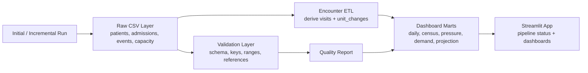

# Hospital Capacity Analytics App

Synthetic hospital capacity analytics application.

This project is a public-safe technical application. It combines a Python synthetic data generator, container-local raw data, validation reports, derived encounter tables, dashboard-prepared outputs, and a Streamlit dashboard. The local version does not use persistent cloud storage; data edits are intended for temporary runtime sessions only.

The raw generated layer is event-level. It stores patient demographics in `patients.csv` and hospital activity in `patient_events.csv`; visit-level tables are derived during ETL rather than stored as raw source files.

## Data safety boundary

All generated data must remain synthetic or explicitly public-safe.

Do not add real SHA data, patient data, internal screenshots, internal table names, private operational numbers, credentials, local network paths, or confidential documents.

## Project layout

```text
hospital-capacity-app/
├── dashboard/streamlit/       Current dashboard draft
├── dashboard/streamlit/utils/ Shared dashboard data, report, and chart helpers
├── data/container/            Committed sample raw, backup, log, and report data
├── data/etl_prepared/         Derived encounter and unit-change ETL outputs
├── data/dashboard_prepared/   Aggregated dashboard output destination
├── docs/                      ETL architecture notes
├── etl/event_editor/          Raw event editor helpers
├── etl/pipeline/              Local ETL pipeline runners
├── etl/synthetic_data_generator/
└── tests/python/
```

## Current local workflow

Install Python dependencies from this folder:

```sh
python -m venv .venv
source .venv/bin/activate
pip install -r requirements.txt
```

Generate synthetic CSV files into the raw container layer:

```sh
python etl/synthetic_data_generator/generate_fake_data.py
```

The generated raw source files include:

```text
patients.csv
admission_chart.csv
patient_events.csv
facilities.csv
services.csv
units.csv
diagnoses.csv
capacity.csv
population_growth.csv
```

`admission_chart.csv` stores one admission/start-state row per visit, including admitted unit, service, diagnosis, facility, admission time, and admission type. `patient_events.csv` stores updates after admission with `type` values of `location`, `service`, `diagnosis`, and `discharge`. Open inpatient encounters simply do not have a discharge event. The ETL derives analytical `visits` from admission chart rows plus the latest service, diagnosis, location, and discharge events.

Initialize the local dataset and rebuild the dashboard-prepared outputs:

```sh
python etl/pipeline/initialize_dataset.py
```

Each run clears the previous container-local raw/report files and overwrites `data/etl_prepared/` and `data/dashboard_prepared/` with the latest derived and aggregated outputs.

The repository includes a committed sample dataset under `data/container/raw/` plus matching prepared outputs under `data/etl_prepared/` and `data/dashboard_prepared/`. This lets the Streamlit app render immediately on first load instead of generating data during startup.

The ETL also writes derived prepared tables to:

```text
data/etl_prepared/
├── visits.csv
└── unit_changes.csv
```

Run the Streamlit dashboard draft:

```sh
streamlit run dashboard/streamlit/Home.py
```

Run the same dashboard in a local container:

```sh
docker compose up --build
```

Then open:

```text
http://localhost:8501
```

The local compose setup mounts `./data` into the container, so generated raw files, backup files, ETL outputs, and dashboard-prepared CSVs remain available on your machine after the container stops.

Stop the local container:

```sh
docker compose down
```

Run Python tests:

```sh
pytest tests/python
```

## Dataset controls

The Streamlit home page includes three main runtime actions:

- **Initial 10-Day Data** regenerates the initial synthetic raw layer, validates it, rebuilds ETL/dashboard outputs, and starts a new `initial_dataset` job log entry.
- **Incremental Run(add next-day data)** appends the next simulated day of raw data, validates duplicate/overlap rules, rebuilds downstream tables, and records an `incremental_run` job.
- **Clear Runtime** removes generated raw data, prepared outputs, reports, and job history. Run Initialize Dataset again when you want fresh data.

The runtime data folders are:

```text
data/container/raw/
data/container/backup/
data/container/reports/
data/container/logs/
data/etl_prepared/
data/dashboard_prepared/
```

## Pipeline workflow

The local app has two run modes:

- `initialize_dataset.py` creates the synthetic raw CSV layer, then calls `mart_layer.py` to validate raw sources, rebuild derived encounter tables, and rewrite dashboard-ready outputs.
- `incremental_run.py` simulates the next day of activity. It appends new raw rows to selected source tables, validates the incremental batch, then rebuilds the derived/dashboard tables from the full raw history.



See [ETL Architecture / Data Flow](docs/etl-architecture-data-flow.md) for the detailed flow.

### Incremental model

The incremental model treats the raw event layer as the source of truth:

```text
Current raw history
        |
        v
Find latest simulated date and next IDs
        |
        v
Generate one new simulated day
        |
        v
Append only to raw source files
  - patients.csv
  - admission_chart.csv
  - patient_events.csv
  - capacity.csv
        |
        v
Validate duplicate keys and overlap with existing raw rows
        |
        v
Rebuild derived encounter/dashboard outputs
```

`visits.csv` and `unit_changes.csv` are not maintained as incremental source tables. They are rebuilt from `admission_chart.csv` and `patient_events.csv` so the dashboard always reflects the complete event history, including late discharge and location events for existing active visits.

### Data check layer

The data check layer exists in two places:

- `data/container/reports/data_check_report.csv` is written during the local pipeline run.
- `data/dashboard_prepared/quality.csv` is the dashboard-facing copy used by the Data Quality page.

The Streamlit home page shows a compact pipeline status summary. The full check details live in the **Data Quality** page and in the CSV reports above.

### Run history

ETL actions are wrapped by a lightweight `EtlJob` context manager in `etl/pipeline/job_logger.py`.

Each job writes one audit row to:

```text
data/container/logs/run_history.csv
```

The run history captures:

```text
job_id
job_type
status
started_at
finished_at
duration_seconds
message
changes
```

The Streamlit **Pipeline Status** panel includes a **Run History** tab that shows recent jobs and lets users inspect the human-readable message and machine-readable change payload for a selected `job_id`.

Current job types include:

- `initial_dataset`
- `incremental_run`
- `user_editor_update`
- `undo_user_edit`
- `etl_refresh`

### User edit undo

The **User Editor** records submitted edits as `user_editor_update` jobs. Each edit job writes human-readable messages to the `message` column and undo-ready structured actions to the `changes` column.

The editor supports undoing the latest submitted edit job only. This keeps the runtime state deterministic when edits depend on each other. After an undo, the app rebuilds the derived ETL/dashboard outputs and removes that job from `edit_history.csv` so the same job cannot be undone twice.
